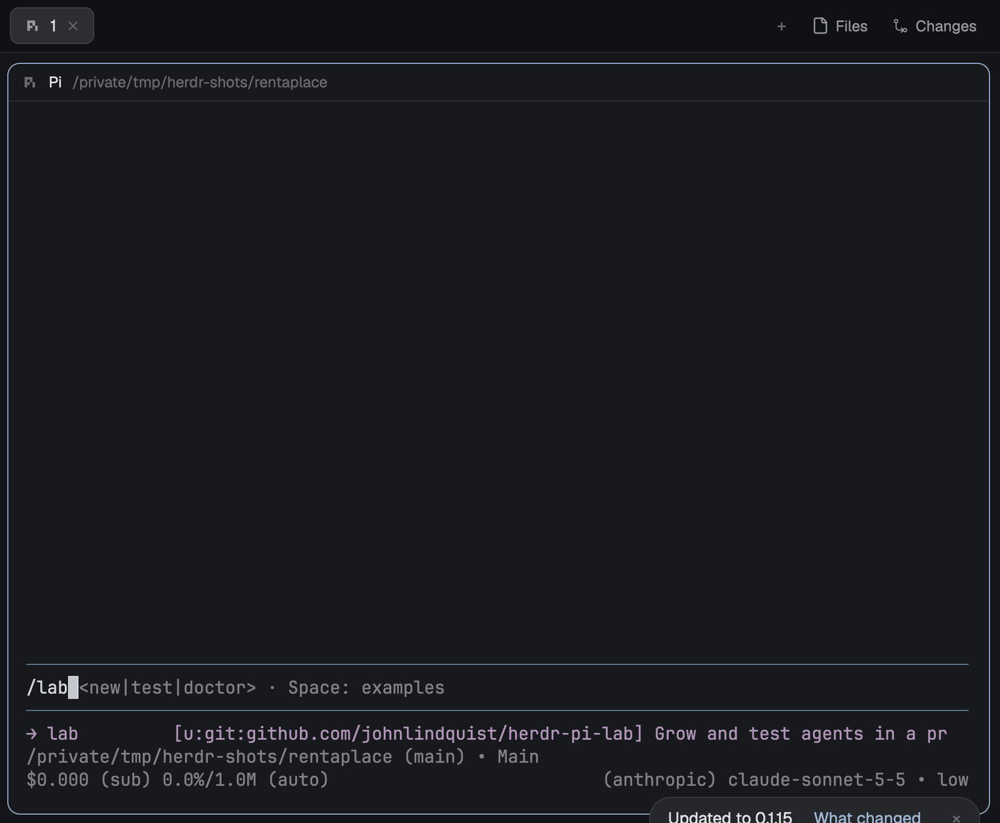
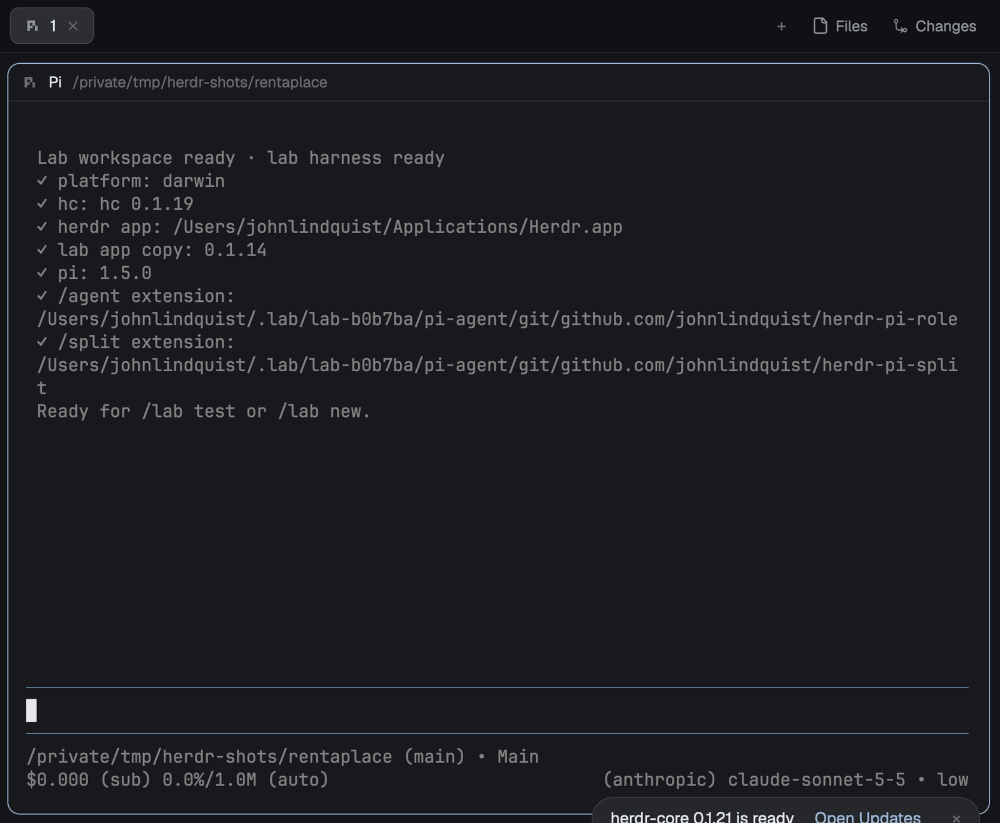
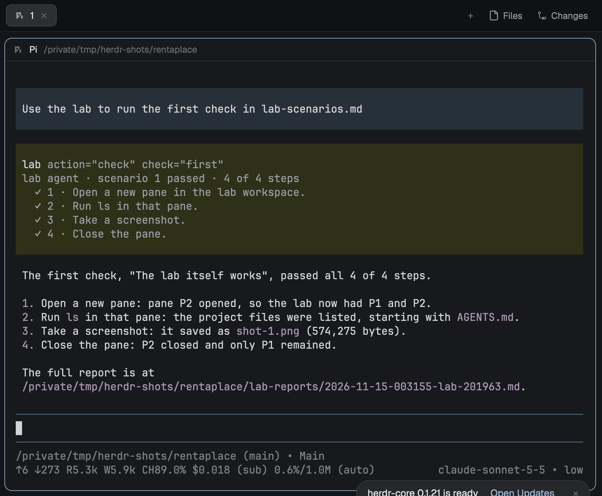
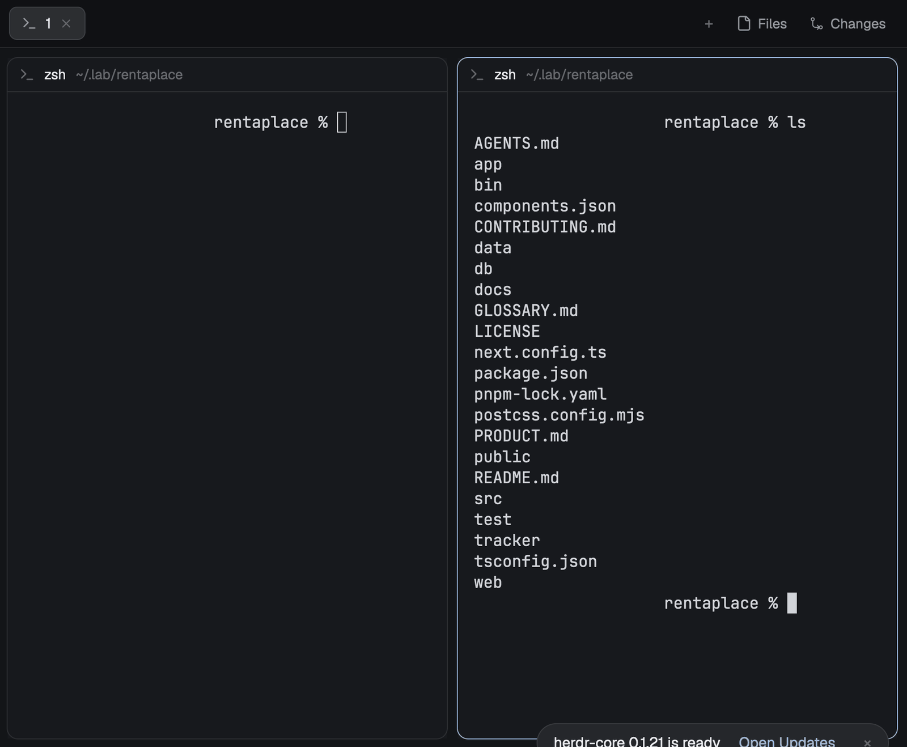

# Herdr Pi Lab

`/lab` for [Pi](https://github.com/earendil-works/pi) and [Herdr](https://github.com/herdrdev/herdr-app): a second, private Herdr window where a lab agent runs plain-word checks and tests your agents from the outside, then reports and cleans up.

This is the lab John Lindquist uses in MEGA.dev S04E01 ("Splitting Conversations, the Lab, and Your First Agents"). The [walkthrough](#the-walkthrough-from-the-video) below follows the video in order.


The screenshots were taken before 2026-11-11, when an agent was still called a role: where a picture says `/role`, `roles/` or `role.md`, read `/agent`, `agents/` and `agent.md`.

## Requirements

- macOS, or Linux (Linux has not been tested yet).
- [Pi](https://github.com/earendil-works/pi) 1.4 or later. Checked with Pi 1.5.0.
- The [Herdr desktop app](https://github.com/herdrdev/herdr-app) 0.1.12 or later, and its command-line tool `hc` (herdr-core 0.1.17 or later) on your PATH. Checked with Herdr 0.1.13 and hc 0.1.19.
- Git, and a model you are signed in to in Pi. Every lab run uses model tokens.
- For `/lab new` and `/lab test <Agent>`: the `/agent` extension ([herdr-pi-role](https://github.com/johnlindquist/herdr-pi-role)) installed in the project you test.
- For the `/split` check: the `/split` extension ([herdr-pi-split](https://github.com/johnlindquist/herdr-pi-split)).

No Docker. Without Herdr or `hc`, `/lab` still loads: `/lab --help` prints the guide, `/lab doctor` says "Lab workspace not ready" and names what is missing, and starting a lab stops with a one-line message.

## Install

```sh
pi install git:github.com/johnlindquist/herdr-pi-lab
```

Then run `/reload` in Pi, and `/lab doctor` once.

The two extensions the walkthrough also uses:

```sh
pi install git:github.com/johnlindquist/herdr-pi-split            # /split, for the second check
pi install --local git:github.com/johnlindquist/herdr-pi-role     # /agent, in the project you test; needed from "/lab new critic" on
```

To update: `pi update --extensions`, then `/reload`. To remove: `pi remove git:github.com/johnlindquist/herdr-pi-lab`.

## The walkthrough from the video

Work in a project of your own, or clone the sample project the video uses: `git clone https://github.com/johnlindquist/rentaplace`. Start Pi in the project, inside a Herdr pane.

The pictures are real captures of a second Herdr window running Pi in a fresh clone of [RentAPlace](https://github.com/johnlindquist/rentaplace), with this extension, `/split` and `/agent` installed from GitHub. The model's wording will differ on your machine.

**The hint.** Type `/lab` and the three things it does appear as dim text after the cursor.



**The doctor.** `/lab doctor` checks everything a lab needs before you rely on it: Herdr, its command line, the app copy the lab window runs, Pi, and whether `/agent` and `/split` are installed.



**A check, asked for in plain words.** Main calls the lab, a lab agent does the steps in a separate window, and the result comes back as one line per step with ✓ or ✗ and what was actually seen.



**The lab window itself.** The steps ran here, not in your workspace: a second Herdr window named Lab, working in a copy of the project at `~/.lab/<project>`. This picture is the screenshot the lab agent saved for step 3 of that check (the computer's name is painted out).



| Step | Type | What you should see |
|---|---|---|
| 1 | `/lab` | Dim text after the cursor: `<new\|test\|doctor>`. Add a space and Pi lists examples; **↑/↓** and **Tab** insert one. |
| 2 | `/lab --help` | The guide. It starts with `Lab · grow and test agents`, then `/lab new <name> — interview, then grow an agent`, `/lab test <name> — run it against its expectations`, `/lab doctor — check the lab workspace and harness`. Nothing is started. |
| 3 | `/lab doctor` | `Lab workspace ready · lab harness ready`, then one line per thing it checked. A ✗ line names what to fix. A ○ line is a note: `/agent` is not needed until step 6. |
| 4 | `Use the lab to run the first check in lab-scenarios.md` | A Herdr Lab window opens with a pane in `~/.lab/<project>`. A lab agent opens a pane, runs `ls`, saves a screenshot and closes the pane. Main shows `scenario 1 passed · 4 of 4 steps` and every step. The lab closes itself. |
| 5 | `Now use the lab to run the /split check` | The lab agent starts Pi in the lab, types `/split`, and reports whether the picker opened and a new pane showed up. |
| 6 | `/lab new critic` | Main asks a few questions, each with a suggested answer. It writes `agents/critic/expectations.md` and waits for your OK. Then it runs the Critic in the lab. |
| 7 | (wait) | A report: one line per expectation with ✓ or ✗, and the file in `agents/critic/reports/`. If one fails, change the agent's job, never the expectations. |
| 8 | `/lab test critic` | The same expectations run again. |

Steps 4 and 5 need the file [`lab-scenarios.md`](#checks) at the root of the project; RentAPlace carries it. Steps 6 to 8 need `/agent` installed in the project (the second install line above).

Three options the video names: `--agent-model provider/id` picks the model the agent runs on (default: a small fast one), `--tester-model provider/id` picks the judge, and `--behind` opens the lab window behind yours for long runs.

What the video draws is an illustration: your file lists, run names and the wording of the model's answers will differ.

## Troubleshooting

| What you see | What to do |
|---|---|
| `/lab` is unknown after installing | Run `/reload`, or restart Pi. `pi list` should show herdr-pi-lab. |
| `/lab doctor`: `✗ hc: … not on PATH` | Install Herdr's command-line tool and check that `hc --version` works in the same shell that starts Pi. |
| `/lab doctor`: `✗ herdr app: Herdr.app not found…` | Install the Herdr desktop app in `/Applications` or `~/Applications`, or set `HERDR_PI_LAB_APP` to where it is. |
| `/lab doctor`: `✗ pi: …` | `pi --version` must work in a plain shell. A personal wrapper script around `pi` can break this; set `HERDR_PI_LAB_PI` to the real `pi`. |
| `The /agent extension was not found in this project` | In the project: `pi install --local git:github.com/johnlindquist/herdr-pi-role`, then `/reload`. |
| The `/split` check reports that `/split` is unknown | `pi install git:github.com/johnlindquist/herdr-pi-split`. `/lab doctor` shows whether the lab found it. |
| `No model is selected` | Choose one with `/model`, or pass `--model provider/id`. |
| The first lab takes a minute to open | The first run makes a copy of the Herdr app named Herdr Lab in `~/.lab/app`, and macOS verifies it once. |
| A lab was left open | `/lab list` shows labs; `/lab stop` closes the last one and `/lab stop all` closes every one. |

## Every command

The lab does more than the video shows. Dim text beside the cursor always tells you what you can type next; it never becomes part of the command. `/lab --help` shows the whole guide without starting a lab, even outside Herdr.

Starting an agent from scratch? `/lab new Concierge` asks you a few questions, writes the expectations first, writes the agent, and runs the lab until the agent passes or needs you.


| Type | What happens |
|---|---|
| `/lab new Concierge` | Grow a new agent: a short interview, expectations for you to approve, then `agent.md`, then the lab until it passes. |
| `/lab new Concierge Look after guests` | Same, starting from a one-line job. |
| `/lab new Critic` | Write expectations for a starter agent (`Critic`, `Notes`, `Research`). |
| `/lab suggest` | Propose up to three agents this project doesn't have, from its own friction: this conversation, your agents' reports, issues and recent commits. Each comes with where the friction was seen and the `/lab new` line that starts it. Builds nothing. |
| `/lab suggest guest support` | Same, looking at one area. |
| `/lab test Critic` | Check an agent from outside against `agents/critic/expectations.md`. Tab completes the agents that have expectations. |
| `/lab test Critic --model anthropic/claude-haiku-5-5` | Choose the model for guest Main and the agent. `--tester-model` chooses the judge; `--behind` opens the window behind yours. |
| `/lab test lab-scenarios.md 1` | Run a [check](#checks) from the scenarios file: a lab agent drives the lab and reports each step. The words after the file choose the check: a number, `first`, or words from it such as `/split`. Nothing after the file runs them all. `--behind` applies. |
| `/lab report Critic` | The latest report for an agent, in this conversation. |
| `/lab list` | Agents with expectations here, and labs on this computer. |
| `/lab stop` | Close the last lab: its window, its core and its scratch files. `/lab stop all` closes every lab. |
| `/lab doctor` | Check the lab workspace (Herdr, `hc`) and the lab harness (Pi), and say whether `/agent` and `/split` were found. |
| `/lab --help` | The guide, with these examples. |

While a lab runs, a checklist above your editor shows each expectation: ○ waiting, ◐ checking, ✓ met, ✗ failed. When it finishes, Main gets one message with the result and the report's path. The lab stays open so you can look; `/lab stop` closes it.

## Checks

A check is a few plain-word steps that a **lab agent** carries out in the lab, without an agent under test or an expectations file. Use it to prove the lab itself works, or that something you built runs inside it. Checks live in `lab-scenarios.md` at the root of your project:

```markdown
# Lab scenarios

## 1 · The lab itself works
Open a new pane in the lab workspace.
Run ls in that pane.
Take a screenshot.
Close the pane.

## 2 · Extensions carry over
Run /split.
Does the picker open?
Does a new pane show up?
```

Each `## heading` is one check and each line under it is one step; a line ending in `?` is a question answered from the screen. This is the file shown in the lesson's video, and the [RentAPlace](https://github.com/johnlindquist/rentaplace/blob/main/lab-scenarios.md) sample project carries it.

Ask Main in plain words, as in the video:

```text
Use the lab to run the first check in lab-scenarios.md
Now use the lab to run the /split check
```

Main calls the `lab` tool's `check` action. Or type it yourself: `/lab test lab-scenarios.md 1`, `/lab test lab-scenarios.md /split`. A check in one sentence, with no file, also works when you ask Main ("use the lab to check that `ls` lists README.md").

What happens:

1. **Isolate.** The lab opens as for any test: its own Herdr, its own core and Pi profile, a copy of the project in `~/.lab/<project>`, with one shell pane, P1. The copy leaves out `lab-scenarios.md` and `lab-reports/`.
2. **Drive.** The lab agent runs in the background of Main, not in the lab window: a headless Pi started in an empty folder with only the lab's driving tools (open a pane, type a line, press keys, read the screens, take a screenshot, close a pane). It has no file, shell or web tools and no knowledge of what it tests. A harness pane is Pi with the extensions that carry over: `/split` ([herdr-pi-split](https://github.com/johnlindquist/herdr-pi-split)) and `/agent`, found in the project's `.pi`, your Pi packages, or a checkout beside this one. Add others with `HERDR_PI_LAB_EXTENSIONS` (paths separated by `:`).
3. **Report and clean up.** Each step comes back as "I tried X, expected Y, got Z" with ✓ or ✗ and a quote. The lab accepts a quote only if it is text the lab itself captured: a pane it read, or its own record of a pane opening, a pane closing or a screenshot being saved. A pass without such a quote is refused. Main gets one line such as `scenario 1 passed · 4 of 4 steps` and every step; the full report goes to `lab-reports/<time>-<run>.md` with the screenshot. Then the lab closes itself: window, core and scratch files.

`--behind` opens the lab window behind yours.

A check is refused before any lab starts when the file is missing, has no checks, or the words match no check or more than one.

## Expectations

Each agent has a folder: `agents/<agent>/expectations.md`, an optional `agent.md`, and `reports/`. A starter agent such as Critic needs only expectations; a new agent's `agent.md` has a `## Job` section, which is the only part `/agent` receives, plus `## Use it when` and `## Examples` for people.

```markdown
# Critic expectations

## Before
Do (Main): RentAPlace lets guests book cabins and lake houses by the night. Reply in one sentence.

## Asks about a skipped decision
Do (Main): Add a minimum stay rule. Don't ask me anything; just tell me the rule you'd add, in one sentence.
Expect (Critic): points out a decision Main assumed, such as how many nights or which homes, and asks about it
Never (Critic): agrees with Main's rule as if the number of nights had been decided

## Only an explicit send reaches Main
Do (Critic): /agent send main Which homes should it cover?
Expect (Main): shows one note from Critic waiting, without starting a new reply
See (Main): "1 agent note"
```

| Line | Who decides |
|---|---|
| `Do (Main): …` / `Do (Critic): …` | The lab types it exactly, as a person would, then waits until Main and the agent go quiet. `Do` lines under `## Before` run before the agent opens. |
| `Run: …` | Only under `## Before`. The lab runs this shell command itself in the project copy before the first prompt, to set up a case such as planting a bug. If it fails, the lab stops and says so. |
| `Expect (…): …` | The Tester judges it from the screen and must quote the pane verbatim. The lab rejects a quote that isn't there. |
| `Never (…): …` | Fails the expectation if it happened. |
| `See (…): "…"` / `Absent (…): "…"` | The lab checks the exact text itself; the Tester can't overrule it. |

`(Agent)` means the agent under test; a line without a pane means Main for Do and the agent otherwise. An agent that changes files or runs commands (a Fixer, say) adds the line `Access: work` under the title of its `agent.md`; the lab then opens it with `/agent --work`, which gives the agent write, edit and shell tools in the project copy (herdr-pi-role from 2026-11-08). Guest Main and other agents keep inspection tools only, so Main can't do the agent's work for it.

Copy the [examples](examples/) into your project's `agents/` folder to start: `critic`, `notes`, `concierge` (a custom agent) and `yesman`, a deliberately bad agent whose report should fail.

## Widgets

`/lab test <name>` also tests a `/widget` panel in `widgets/<name>/`, when that folder has an `expectations.md` beside `widget.json`.

- The lab copies the `widget` Herdr mod into the lab window's own app folder and loads the project's `/widget` extension in guest Main. Your everyday window and `widget.json` are untouched. Each widget's `state/` is cleared in the copy.
- The widget opens beside guest Main on its saved `sample.txt` whenever it has one. Without a sample, a command-line source runs in the project copy; a script or MCP source is refused, because it may read outside the project. A widget whose source reads only what the lab owns (the project copy, or guest Main's Pi session under `PI_CODING_AGENT_DIR`) sets `"lab": "live"` in `widget.json` and runs live in the lab. After a Main step the lab waits for the widget's next refresh, unless the widget runs on its saved sample, which a refresh can't change.
- `Do (Main)` lines are typed into Main. `Do (<widget>)` lines say in plain words what to do on the panel ("refresh", "Keep", "select the first item and send it to Main"); the Tester does it with the panel's own keys or buttons (`lab_widget`). The name in brackets is `Main` or the widget's name; a line without one means the widget.
- After each step the lab waits until the widget is quiet (no refresh or action running, its text unchanged) and Main is idle. The Tester judges Expect and Never from the text the widget and Main show and from the project files that changed (quote them as `Files`). It may read the saved sample (`lab_sample`), never `instructions.md`.
- `--widget-model provider/id` sets the widget's model for one run, in the copy only.
- Reports go to `widgets/<name>/reports/` in your project.

In a lab, the panel writes what it shows to `state/shown.txt` and takes `press-<key>` and `click-item-<n>` commands; outside a lab it does neither.

## What a lab is

- **Its own Herdr:** a copy of your Herdr app with its own identity (`dev.herdr.lab`, named Herdr Lab), so macOS never confuses it with your everyday Herdr. It starts its own core (`HC_SESSION=lab-…`) and app home, with your Herdr look and keys.
- **Its own Pi:** a scratch Pi profile that links to your model logins (`auth.json`, `models.json`) instead of copying them. Guest Main loads only the `/agent` extension from your project, so other extensions don't change the result.
- **A copy of your project** in `~/.lab/<project>` (for RentAPlace, `~/.lab/rentaplace`; a second lab on the same project at the same time gets `~/.lab/<project>-<run>`): tracked files only, without `.git`, `.pi`, secrets-looking files, `agents/` or any `expectations.md`, so the agent can't read its own test. The copy starts as a fresh repository with one commit, `Lab copy`.
  - **The one exception (0.5.0): the tested agent's own files.** `/lab test booking` also copies the files directly inside `agents/booking/`: `agent.md` and whatever knowledge the agent keeps beside it, such as `memories.md`, `glossary.md` and `owns.txt`. That folder is the agent, and a job that says "answer from the glossary beside this file" needs the glossary. Still left out of that folder: `expectations.md`, any file with "expectation" in its name, and every subfolder, so `reports/` stays out too. Other agents' folders stay out whole, and a check (`/lab test lab-scenarios.md`) copies no agent folder at all. The rule is one function, `labCopies` in [`core.mjs`](core.mjs).
- **A Tester that can't look inside:** a separate Pi started with only the lab's tools: type an expectation's steps, read a guest pane, find text, record a verdict, finish. No file, shell or web tools.
- **Reports:** `agents/<agent>/reports/<time>-<run>.md` with every verdict, its quotes, the lab's own checks, the final screens and a screenshot of the lab window.
- **A lab agent for checks:** a headless Pi in the background of Main with only the tools that drive the lab; see [Checks](#checks).
- **Teardown:** `/lab stop` ends that lab's terminals, quits that window, stops that core and removes that lab's project copy and its scratch folder `~/.lab/<run>`. Nothing else is signaled. Labs started by a version before 0.4.0 lived in `~/.herdr-lab`; `/lab list` and `/lab stop` still find them.

Set `HERDR_PI_LAB_BEHIND=1` to open every lab behind your windows, for unattended runs.

Each lab run uses model tokens for guest Main, the agent and the Tester. By default all three use the model of the conversation you start it from.

**Limits.** The lab runs as you, on your computer: the agent can still read files outside the project copy and use the network. Use it for agents you're building, not for untrusted code. Judgments come from a model; See/Absent lines and quote checks are exact. The Tester reads what's on screen now, so a long answer that scrolled away can't be quoted.

The agent opens with `/agent NAME --model fast`: the fast default (Haiku) that `/agent` gives people, so the lab tests what you'll actually use. Pass `--agent-model provider/id` or `--agent-model main` to test another. This needs herdr-pi-role from 2026-11-07 or later; an older `/agent` rejects `fast`.

## Agent interface

The `lab` tool gives an agent the same operations: `help`, `doctor`, `agents`, `check {file?, check?, say?, model?, behind?}` (runs checks from `lab-scenarios.md`, or one in plain words with `say`; waits and returns every step with its quote), `test {role, model?, testerModel?, behind?}` (returns the run ID at once), `wait {run, seconds?}` (every verdict with evidence), `status {run}`, `list`, `report {role}`, `stop {run}`. `/lab new` uses it to run the lab after writing an agent.

From a shell or CI:

```sh
node lab.mjs doctor
node lab.mjs check Critic                          # parse the expectations, start nothing
node lab.mjs test Critic --model anthropic/claude-haiku-5-5 --tester-model anthropic/claude-sonnet-5-5 --behind --wait
node lab.mjs scenarios                             # parse lab-scenarios.md, start nothing
node lab.mjs test lab-scenarios.md first --model anthropic/claude-haiku-5-5 --behind
node lab.mjs test lab-scenarios.md /split --model anthropic/claude-haiku-5-5 --behind
node lab.mjs test --say "Open a pane. Run ls. Close the pane." --model anthropic/claude-haiku-5-5 --behind
node lab.mjs list | stop RUN | stop all | leftovers
```

A check always waits, prints every step, and stops its lab unless `--keep`; it exits the same way. `test --wait` prints every verdict and exits 0 when all expectations pass, 1 when one fails, 2 when the lab couldn't run. It stops the lab afterwards unless `--keep`.

## How it maps to the MEGA.dev lesson

This is John Lindquist's own build of the lab from MEGA.dev S04E01 ("Splitting Conversations, the Lab, and Your First Agents"). The lesson teaches you to build your own for whatever harness and workspace you use; this repository is the finished Pi and Herdr version to compare with. Its siblings are [`/split`](https://github.com/johnlindquist/herdr-pi-split) and [`/agent`](https://github.com/johnlindquist/herdr-pi-role).

| In the lesson | Here |
|---|---|
| Step one, isolate: a separate copy of the workspace that shares your model sign-in, and a copy of the project | [What a lab is](#what-a-lab-is): its own Herdr (`dev.herdr.lab`), its own core and Pi profile linked to your logins, a copy of the tracked files in `~/.lab/<project>` |
| Step two, drive: type and press keys like a person, read only what is on screen | The lab types each `Do` line with `hc`; the Tester reads the panes and must quote them |
| Step three, report and clean up | `agents/<agent>/reports/<time>-<run>.md` with a screenshot; `/lab stop` closes that window, that core and its scratch files |
| `/lab` with the ghost text `<new\|test\|doctor>`, `/lab --help`, `/lab doctor` | The same three. `/lab doctor` leads with `Lab workspace ready · lab harness ready` |
| The lab pane's folder, `~/.lab/rentaplace` | The project copy, in the same place |
| "Use the lab to run the first check in lab-scenarios.md": open a pane, run `ls`, take a screenshot, close the pane | [Checks](#checks): Main calls the `lab` tool's `check` action; the lab agent opens P2, types `ls`, saves a screenshot of the lab window and closes P2. Main shows `scenario 1 passed · 4 of 4 steps` |
| "Now use the lab to run the /split check": does the picker open, does a new pane show up | The same action with `check: "/split"`. The lab agent opens a harness pane, sends one short prompt, types `/split`, quotes the picker, presses Enter and looks for the new pane |
| The lab agent reports in the background of Main; the lab window shows only what it drives | The lab agent is a headless Pi with no pane of its own; Main shows its steps |
| "I tried X, expected Y, but I got Z", with a tick or a cross | Each step in Main's message and in `lab-reports/` |
| An expectations file: Do, Expect, Never | `agents/<agent>/expectations.md`. Do, Expect and Never are lines under one `## heading` per expectation, with the pane in brackets; see [Expectations](#expectations) |
| The Critic's three checks | [examples/critic/expectations.md](examples/critic/expectations.md) |
| `/lab new critic`, then `/lab test critic` | The same. Names are not case sensitive |
| `--agent-model`, `--tester-model`, `--behind` | The same flags |
| Change the agent's job, never loosen the expectations | `/lab new` is told to change the `## Job` in `agent.md` after a failed run, and never the expectations unless you agree one was wrong |

**Differences from the video.** The video's slides are drawn, not captured, so file lists, run names and model answers are examples. Two real differences: after an agent test the lab stays open for you to look until `/lab stop`, while a check closes its own lab; and the reports of a check go to `lab-reports/` in your project, not into the lab's folder. The traps the isolation step ran into are written down in [TESTING.md](TESTING.md) under "Findings that changed the code".

## How it is built

| File | What it holds |
|---|---|
| [`index.ts`](index.ts) | The Pi extension: the `/lab` command, the `lab` tool, the checklist above the editor. |
| [`guidance.ts`](guidance.ts) | What `/lab` teaches while you type: examples, ghost text, the `--help` guide. |
| [`core.mjs`](core.mjs) | The lab itself: isolate (the Herdr Lab app copy, a private core, a scratch Pi profile, the project copy), drive (`hc` and `herdr-app` calls), stop and clean up, `doctor`. |
| [`scenarios.mjs`](scenarios.mjs) | Reads `lab-scenarios.md` and chooses a check from plain words. |
| [`checker/`](checker/) | The lab agent for checks: its six driving tools and its prompt. |
| [`expectations.mjs`](expectations.mjs) | Reads an agent's `expectations.md`. |
| [`tester/`](tester/) | The Black-box tester for agents: its tools and its prompt. |
| [`report.mjs`](report.mjs) | Writes the report. |
| [`new-agent.md`](new-agent.md), [`suggest.md`](suggest.md) | The briefs Main gets for `/lab new` and `/lab suggest`. |
| [`lab.mjs`](lab.mjs) | The same operations from a shell. |
| [`examples/`](examples/), [`test/`](test/) | Expectations to copy, and the unit tests. |

## Building the same for another harness or workspace

The lesson teaches you to build your own lab; this one is a reference, not a requirement. A lab needs three things from your tools:

1. **Isolate.** A second copy of the workspace that cannot reach your everyday one, a copy of the project, and your model sign-in shared with it. Here: a renamed copy of the Herdr app with its own core and a scratch Pi profile. With a terminal multiplexer, a separate server with its own socket does the same.
2. **Drive.** A command line that can open a pane, type text, press keys and read what a pane shows, and ideally take a screenshot. Here: `hc` and `herdr-app`. The agent that drives gets only those tools, so it cannot read the code it tests.
3. **Report and clean up.** A result per step with a quote from the screen, and a stop that removes everything the lab started.

`core.mjs` is where those three live; replace its `hc` and `herdr-app` calls with your workspace's. The sibling extensions are [`/split`](https://github.com/johnlindquist/herdr-pi-split) and [`/agent`](https://github.com/johnlindquist/herdr-pi-role).

## Testing

See [TESTING.md](TESTING.md) for the real runs behind this README. Unit tests, which need neither Herdr nor a model:

```sh
bun test
```

**Running a check without a window.** `--detached` is a testing aid, for machines and automated runs where no window may open. It is not part of the walkthrough and Pi does not suggest it while you type. The lab's panes are then plain terminals in the lab's own core:

```sh
node lab.mjs test lab-scenarios.md first --model anthropic/claude-haiku-5-5 --detached
```

A detached lab cannot take a screenshot, and `/split` cannot open a pane in it because `/split` needs a Herdr window, so those steps fail and say why. The first check ends `3 of 4 steps` there. `/lab test lab-scenarios.md 1 --detached` and the tool's `detached: true` do the same.

## License

MIT
