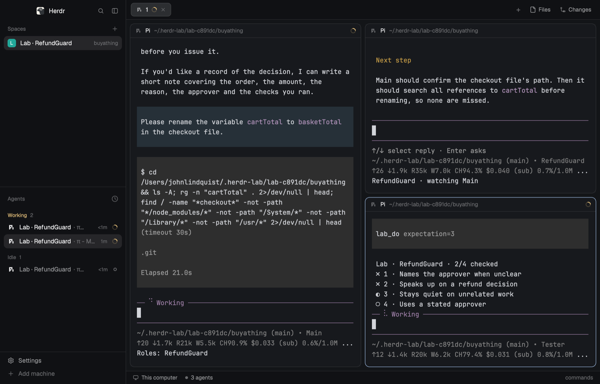
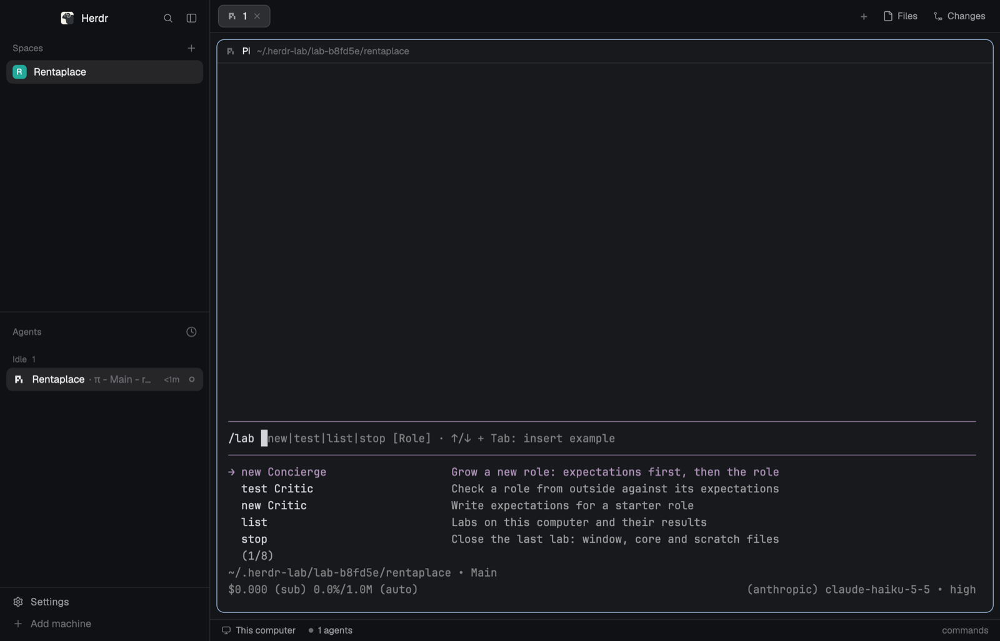

# Herdr Pi Lab

Grow and test Pi roles in a private Herdr. Type `/lab test Critic` and a second Herdr window, **Herdr Lab**, opens beside your own. Its guest Main opens the Critic with `/role`, and a **Black-box tester** below it types the steps from the Critic's expectations, reads what actually appeared and writes a report. The Tester never sees the role's instructions, and your everyday Herdr, Pi sessions and project are never touched.



Starting a role from scratch? `/lab new Concierge` asks you a few questions, writes the expectations first, writes the role, and runs the lab until the role passes or needs you.

## Install

Requires macOS or Linux with the [Herdr desktop app](https://github.com/herdrdev/herdr-app) (0.1.12+), `hc` (herdr-core 0.1.17+) and [Pi](https://github.com/earendil-works/pi) 1.4+, plus the `/role` extension ([herdr-pi-role](https://github.com/johnlindquist/herdr-pi-role)) in the project you're testing. No Docker.

```sh
pi install git:github.com/johnlindquist/herdr-pi-lab
```

Then run `/reload` in Pi, and `/lab doctor` once. To remove it: `pi remove git:github.com/johnlindquist/herdr-pi-lab`. While the repository is private, your GitHub account needs read access.

## Use

Type `/lab` and a space: Pi lists examples. Use **↑/↓** and **Tab** to insert one, then edit it. Dim text beside the cursor tells you what you can type next; it never becomes part of the command. `/lab --help` shows the whole guide without starting a lab, even outside Herdr.



| Type | What happens |
|---|---|
| `/lab new Concierge` | Grow a new role: a short interview, expectations for you to approve, then `role.md`, then the lab until it passes. |
| `/lab new Concierge Look after guests` | Same, starting from a one-line job. |
| `/lab new Critic` | Write expectations for a starter role (`Critic`, `Notes`, `Research`). |
| `/lab test Critic` | Check a role from outside against `roles/critic/expectations.md`. Tab completes the roles that have expectations. |
| `/lab test Critic --model anthropic/claude-haiku-5-5` | Choose the model for guest Main and the role. `--tester-model` chooses the judge; `--behind` opens the window behind yours. |
| `/lab report Critic` | The latest report for a role, in this conversation. |
| `/lab list` | Roles with expectations here, and labs on this computer. |
| `/lab stop` | Close the last lab: its window, its core and its scratch files. `/lab stop all` closes every lab. |
| `/lab doctor` | Check Herdr, hc, Pi and `/role` before your first lab. |
| `/lab --help` | The guide, with these examples. |

While a lab runs, a checklist above your editor shows each expectation: ○ waiting, ◐ checking, ✓ met, ✗ failed. When it finishes, Main gets one message with the result and the report's path. The lab stays open so you can look; `/lab stop` closes it.

## Expectations

Each role has a folder: `roles/<role>/expectations.md`, an optional `role.md`, and `reports/`. A starter role such as Critic needs only expectations; a new role's `role.md` has a `## Job` section, which is the only part `/role` receives, plus `## Use it when` and `## Examples` for people.

```markdown
# Critic expectations

## Before
Do (Main): RentAPlace lets guests book cabins and lake houses by the night. Reply in one sentence.

## Asks about a skipped decision
Do (Main): Add a minimum stay rule. Don't ask me anything; just tell me the rule you'd add, in one sentence.
Expect (Critic): points out a decision Main assumed, such as how many nights or which homes, and asks about it
Never (Critic): agrees with Main's rule as if the number of nights had been decided

## Only an explicit send reaches Main
Do (Critic): /role send main Which homes should it cover?
Expect (Main): shows one note from Critic waiting, without starting a new reply
See (Main): "1 role note"
```

| Line | Who decides |
|---|---|
| `Do (Main): …` / `Do (Critic): …` | The lab types it exactly, as a person would, then waits until Main and the role go quiet. `Do` lines under `## Before` run before the role opens. |
| `Expect (…): …` | The Tester judges it from the screen and must quote the pane verbatim. The lab rejects a quote that isn't there. |
| `Never (…): …` | Fails the expectation if it happened. |
| `See (…): "…"` / `Absent (…): "…"` | The lab checks the exact text itself; the Tester can't overrule it. |

`(Role)` means the role under test; a line without a pane means Main for Do and the role otherwise. Copy the [examples](examples/) into your project's `roles/` folder to start: `critic`, `notes`, `concierge` (a custom role) and `yesman`, a deliberately bad role whose report should fail.

## What a lab is

- **Its own Herdr:** a copy of your Herdr app with its own identity (`dev.herdr.lab`, named Herdr Lab), so macOS never confuses it with your everyday Herdr. It starts its own core (`HC_SESSION=lab-…`) and app home, with your Herdr look and keys.
- **Its own Pi:** a scratch Pi profile that links to your model logins (`auth.json`, `models.json`) instead of copying them. Guest Main loads only the `/role` extension from your project, so other extensions don't change the result.
- **A copy of your project:** tracked files only, without `.git`, `.pi`, secrets-looking files, `roles/` or any `expectations.md`, so the role can't read its own test.
- **A Tester that can't look inside:** a separate Pi started with only the lab's tools: type an expectation's steps, read a guest pane, find text, record a verdict, finish. No file, shell or web tools.
- **Reports:** `roles/<role>/reports/<time>-<run>.md` with every verdict, its quotes, the lab's own checks, the final screens and a screenshot of the lab window.
- **Teardown:** `/lab stop` ends that lab's terminals, quits that window, stops that core and removes `~/.herdr-lab/<run>`. Nothing else is signaled.

Each lab run uses model tokens for guest Main, the role and the Tester. By default all three use the model of the conversation you start it from.

**Limits.** The lab runs as you, on your computer: the role can still read files outside the project copy and use the network. Use it for roles you're building, not for untrusted code. Judgments come from a model; See/Absent lines and quote checks are exact. The Tester reads what's on screen now, so a long answer that scrolled away can't be quoted.

The role opens with `/role NAME --model fast`: the fast default (Haiku) that `/role` gives people, so the lab tests what you'll actually use. Pass `--role-model provider/id` or `--role-model main` to test another. This needs herdr-pi-role from 2026-11-07 or later; an older `/role` rejects `fast`.

## Agent interface

The `lab` tool gives an agent the same operations: `help`, `doctor`, `roles`, `test {role, model?, testerModel?, behind?}` (returns the run ID at once), `wait {run, seconds?}` (every verdict with evidence), `status {run}`, `list`, `report {role}`, `stop {run}`. `/lab new` uses it to run the lab after writing a role.

From a shell or CI:

```sh
node lab.mjs doctor
node lab.mjs check Critic                          # parse the expectations, start nothing
node lab.mjs test Critic --model anthropic/claude-haiku-5-5 --tester-model anthropic/claude-sonnet-5-5 --behind --wait
node lab.mjs list | stop RUN | stop all | leftovers
```

`test --wait` prints every verdict and exits 0 when all expectations pass, 1 when one fails, 2 when the lab couldn't run. It stops the lab afterwards unless `--keep`.

## Tested

See [TESTING.md](TESTING.md) for the real runs behind this README. Unit tests:

```sh
bun test
```

## License

MIT
